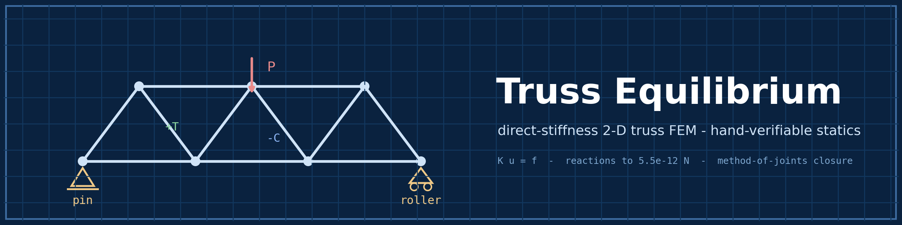
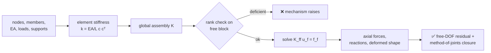
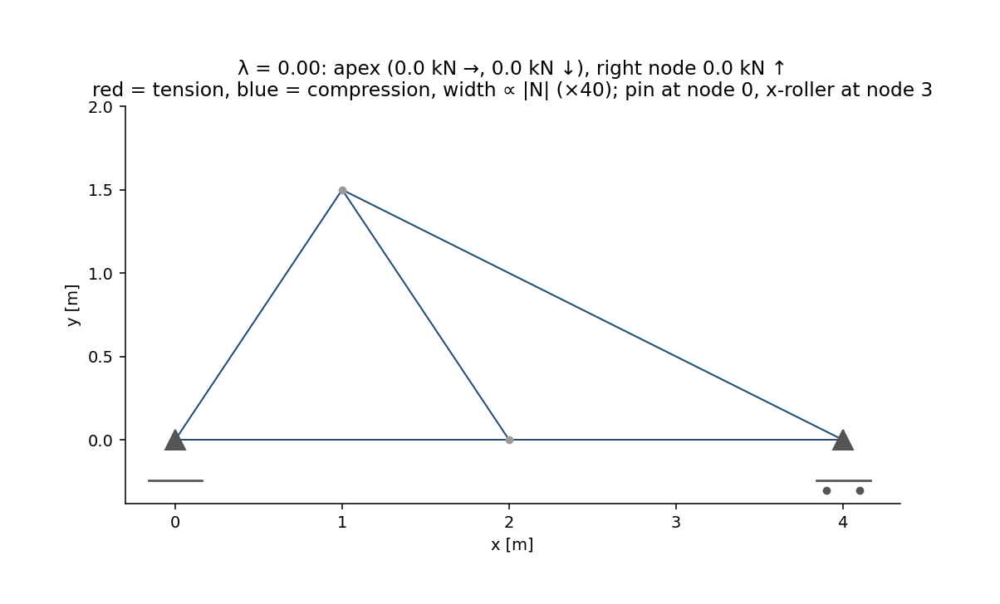

<div align="center">



# 🏗️ Truss Equilibrium

### Forces, displacement & reactions from first principles

**An original 2D truss finite-element solver — direct stiffness assembly,
hand-verifiable statics, and method-of-joints closure — with member forces matching
analytic spring/truss solutions to 1e-12 and free-DOF equilibrium residuals at
roundoff.**

[](https://github.com/khalil-work/truss-equilibrium/actions/workflows/ci.yml)
[](LICENSE)
[](requirements.txt)
[](tests)
[](docs/verification.md)
[](https://github.com/khalil-work/truss-equilibrium/stargazers)
[](https://github.com/khalil-work/truss-equilibrium/commits)

[Quick start](#-quick-start) · [Method](#-model-method-and-checks) · [Animation](#%EF%B8%8F-results-gallery) · [Metrics](#-results-and-metrics-benchmark-truss) · [References](#-references)

</div>

---

## 🎯 Purpose and scope

A compact, readable direct-stiffness truss solver for learning and quick
**verification-first structural analysis**: every result closes equilibrium and the
hand solutions are reproducible to 1e-12.

> **Scope:** 2D, linear elastic, axial members, homogeneous supports, static loads.
> Not a frame/beam solver, no buckling or geometric nonlinearity.

| | |
| --- | --- |
| 🧮 **Assembly** | bar element stiffness (EA/L) with direction cosines → global matrix |
| 🔀 **Solve** | dense solve of the free block after an explicit rank check (mechanisms raise, never return garbage) |
| 📤 **Post-processing** | axial forces (tension +), reactions, free-DOF residual, deformed geometry |
| ✅ **Anchors** | parallel-spring load sharing; classic apex-load hand solution; method-of-joints closure at every node |

## 🧮 Model, method, and checks

- Bar element stiffness (EA/L) with direction cosines; global assembly; dense solve
  of the free block after an explicit rank check (mechanisms raise, never return
  garbage).
- Post-processing: axial forces (tension +), reactions, free-DOF residual (the
  actual solver error measure), deformed geometry.
- Verification anchors: parallel-spring load sharing; classic apex-load truss hand
  solution; method-of-joints closure at every node; EA scaling; rotation
  consistency.

Full derivation: [docs/model.md](docs/model.md); API: [docs/api.md](docs/api.md).

### Nodes and members to reactions



## ⚡ Quick start

```bash
python -m pip install -r requirements-dev.txt
python -m pytest tests -q                       # 11 verification tests
python examples/run_verification.py             # figures + GIF + raw data
```

Verified: Python 3.13.5, NumPy 2.1.3, Windows 11; CI on Ubuntu. Tests < 1 s;
results script ≈ 5 s.

<details>
<summary><b>🧱 Architecture & API example</b></summary>

```
truss_equilibrium/
└── truss.py            # element_stiffness, TrussProblem, solve_truss
tests/test_truss.py     # 11 verification tests
examples/run_verification.py
docs/ model.md  api.md  verification.md  results/
```

```python
import numpy as np
from truss_equilibrium import TrussProblem, solve_truss

nodes = [(0.0, 0.0), (1.0, 0.5), (2.0, 0.0)]
problem = TrussProblem(nodes, [(0, 1, 1.0e6), (1, 2, 1.0e6)],
                       np.array([0, 0, 0, -1.0e3, 0, 0]),
                       fixed_dofs=[0, 1, 4, 5])
result = solve_truss(problem)
print(result["axial_forces"], result["equilibrium_residual"])
```

</details>

## ✅ Verification

Eleven tests: finite public-API validation, fractional-support/bool-index rejection,
all-constrained support, analytic spring load-sharing, hand-solved apex truss,
node-by-node joints closure on an irregular random-load truss, stiffness symmetry +
mechanism detection, EA scaling, rotated-element consistency, input validation, and
a benchmark regression pinning the documented supports (pin node 0, roller DOF 7 at
node 3) with hand reactions (−3000, 13875, −8875) N, zero roller vertical
displacement and nonzero apex displacement. Evidence and limits:
[docs/verification.md](docs/verification.md).

## ⚠️ Limitations

- Linear static, axial-only, homogeneous supports; no beams, buckling, self-weight,
  or dynamics.
- Dense solver — educational scale (tens of members), not sparse industrial scale.
- Verification is analytic/algebraic; no experimental correlation claimed.

---

## 🎞️ Results gallery

<div align="center">

**▶ Watch the truss respond as the load grows:**



<sub>41 frames — the entire benchmark load vector (apex +3 kN horizontal
and −20 kN vertical, right node +15 kN) ramps by λ = 0…1, so frame 0 is
genuinely unloaded; each frame is a fully solved truss at that load (fixed
axes, ×40 displacement exaggeration, light-grey undeformed geometry, pin
at node 0 / x-roller at node 3 markers and load arrows). Red =
tension, blue = compression, width ∝ |N|. Produced by
<code>examples/run_verification.py</code>.</sub>

</div>

### 📈 Results and metrics (benchmark truss)

Pin at node 0 + vertical roller at node 3; apex (+3 kN →, −20 kN ↓),
right node +15 kN ↑.

| Metric | Value |
| --- | --- |
| Free-DOF equilibrium residual | **1.5e-11 N** |
| Statics closure ΣF_x, ΣF_y | 0 N, −5.5e-12 N |
| Reactions vs independent hand statics | R0x = −3000, R0y = 13875, R3y = −8875 N; **max error 5.5e-12 N** |
| Roller-support vertical displacement | exactly 0 m (node 3 stays on its support) |
| Analytic spring/truss solutions | matched to 1e-12 (25 N load sharing; ±P/(2 sin 45°)) |
| Method-of-joints closure (every node) | < 5e-7 N |
| Max tension / compression | 12.3 kN / 16.7 kN |
| Max displacement | 2.04 mm (apex 1.98 mm) |

### 🖼️ Static figures & raw data

Raw data: [docs/results/](docs/results) — `member_forces.csv`, `reactions.csv`,
`displacements.csv`, `run_summary.json`; cover
[benchmark_solution.png](docs/results/benchmark_solution.png), deformed shape
[deformed_geometry.png](docs/results/deformed_geometry.png).

## 📚 References

- J. S. Przemieniecki, *Theory of Matrix Structural Analysis* (direct stiffness
  method).
- R. D. Cook et al., *Concepts and Applications of Finite Element Analysis*.
- R. C. Hibbeler, *Structural Analysis* (method of joints context).

Dependencies: NumPy (BSD-3), Matplotlib (PSF-based), Pillow (HPND), pytest
(MIT). This repository's own code is original and MIT-licensed; see
[LICENSE](LICENSE).
